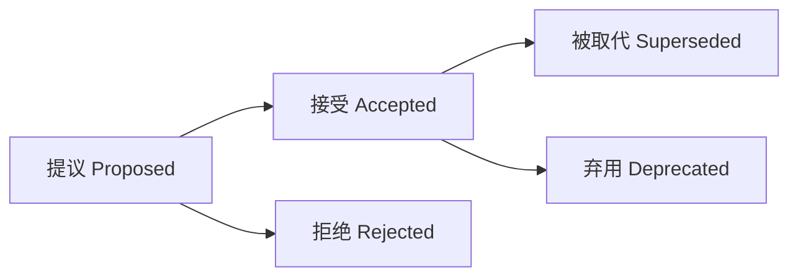

# 架构决策记录（Architecture Decision Record, ADR）

> **类型**：概念卡片  
> **领域**：软件工程 / 软件架构 / 架构知识管理  
> **核心问题**：在当时的条件下，为什么选择这个方案，并接受哪些代价？

## 1. 定义与价值

**ADR 是围绕一个具有架构意义的决策，简要保存其背景、选择理由及后果的记录，使后来者能够理解、检查和重新评估这一选择。**[^nygard][^microsoft]

“具有架构意义”通常指影响系统结构、质量属性、依赖关系、接口，或难以逆转的选择，例如数据库选型、服务拆分和一致性策略。判断重点是决策的影响，而非技术名称是否显得重要。[^nygard][^microsoft]

ADR 保存的是**有条件的判断**：某方案在特定需求、约束和证据下被接受，不等于它在任何情境下都最优。它像一份简短的“工程判决书”：既给出结论，也留下适用条件和取舍，帮助团队避免不理解历史就沿用或推翻设计。[^nygard]

Michael Nygard 于 2011 年发表的文章推广了这种轻量记录方式；该文章是 ADR 的重要实践来源，不应据此把更广泛的“架构决策与理由记录”归为始于 2011 年。[^nygard][^community]

## 2. 核心结构

不同模板并无统一的必填字段标准。Nygard 的经典结构包含标题、背景、决策、状态和后果；MADR 等模板进一步显式记录候选方案、决策驱动因素与验证方式。[^nygard][^madr]

| 要素 | 应回答的问题 |
| --- | --- |
| 标识与状态 | 这是哪个决策？何时提出或接受？当前是否有效？ |
| 背景与约束 | 要解决什么问题？需求、规模、资源和假设是什么？ |
| 候选方案 | 有哪些可行选项？为何没有选其他方案？ |
| 决策与理由 | 明确选择什么？哪项约束或证据决定了取舍？ |
| 后果 | 获得什么收益？承担什么成本、限制与风险？ |
| 验证与关联（按需） | 如何检查落实情况？依赖或取代哪些决策？ |

背景应尽量区分**事实、假设与尚待验证的判断**；证据不足时可记录决策置信度。后果应同时覆盖收益和代价，避免把 ADR 写成选定方案的宣传材料。[^microsoft][^madr]

可用下面一句话检验记录是否完整（这是便于理解的归纳，不是标准模板）：

> 在【背景与约束】下，我们选择【方案】，因为【理由】；为此接受【代价】，并在【条件变化】时重新评估。

## 3. 生命周期与维护

常见状态流转如下；具体名称可由团队约定。[^aws-process][^nygard]



- **提议阶段**：在决策过程中形成草稿，由相关人员评审，可继续修改。
- **接受或拒绝后**：保留当时的理由与结论。若实质决策改变，新建 ADR；旧记录只更新状态和替代链接，避免覆盖历史。
- **被取代**表示已有新决策接替；**弃用**表示不再适用，不一定存在替代者。[^aws-process][^nygard]

多个 ADR 构成项目的**决策日志（decision log）**。一种决策的后果可能成为下一项决策的背景，因此记录之间应建立必要的引用。[^aws-process][^nygard]

实践上，可将 Markdown 文件存放在 `docs/adr/` 或 `docs/decisions/`，通过 PR 评审，并从设计文档或代码评审中引用。Git 便于版本管理；Wiki 或专用工具也可使用，关键是团队能够访问并追溯历史。[^archyl][^aws-practices]

## 4. 适用范围与概念边界

优先记录影响面大、存在重要取舍、逆转成本高，或未来容易被质疑的决策。通常无需逐一记录已被现有规则覆盖的常规选择；但库、工具或流程选型若具有架构影响，同样可以形成 ADR。[^microsoft][^nygard]

| 相关文档 | 主要用途 | 与 ADR 的关系 |
| --- | --- | --- |
| 设计文档 | 展开整体方案、交互与实现细节 | ADR 聚焦其中一个重要选择及理由，可链接详细设计 |
| RFC（征求意见稿） | 提出方案，收集意见并促成决策 | 可为 ADR 提供讨论依据；提议状态的 ADR 也可承担部分讨论功能 |
| 会议纪要 | 保存讨论过程、参与情况与行动项 | ADR 提炼决策结论、理由与后果 |
| 架构图 | 表达系统的结构和关系 | 可链接 ADR，补充“为何形成这种结构” |

以上是用途上的区分，并非互斥的文件分类；文档可以相互引用。[^archyl][^cnblogs]

**简短不等于省略理由。**一条 ADR 聚焦一个决策，通常以一至两页为目标；篇幅是可读性建议，不是统一硬限制。ADR 也不会自动保证代码遵守决策，可结合代码评审、架构测试等手段检查实施情况。[^nygard][^madr]

## 5. 最小示例

以下为说明结构而构造的假设案例，不构成通用数据库选型建议。

```markdown
# ADR-0007：订单主库采用 PostgreSQL

- 状态：接受
- 日期：2026-10-19

## 背景
订单与明细需要原子提交；团队已有 PostgreSQL 运维经验。
预计单库可满足近期负载，但这一假设尚需压测确认。

## 备选与决策
选择 PostgreSQL，主要依据是关系约束、事务需求及团队经验。
未选择文档数据库：当前没有足以抵消迁移和学习成本的需求。

## 后果与验证
收益：可在单一事务中维护订单及明细的一致性。
代价：承担模式迁移、备份恢复与容量管理工作。
验证：执行事务一致性测试、负载测试及恢复演练。
复议条件：压测不满足目标，或出现必须跨库扩展的新约束。
```

## 6. 知识网络

- **上位概念**：[[架构知识管理]]——ADR 是保存架构知识的载体；[[设计理由]]——ADR 将理由落实到具体决策。
- **具体形式**：Nygard 式 ADR、MADR——同一记录思想的不同模板，不代表不同层级的架构。
- **关联概念**：[[质量属性]]提供决策依据；[[技术债务]]可记录已接受代价中需要后续处理的部分；[[RFC]]支持讨论；[[C4模型]]为决策提供结构上下文。

## 7. 参考资料与来源说明

定义和维护原则优先依据原始实践文章、微软与 AWS 官方指南及 MADR 项目文档；用户提供的 Archyl 和博客园文章用于补充理解与落地场景。本文是概念综合，不将实践建议表述为已获实验验证的因果结论。

[^nygard]: Michael Nygard. [Documenting Architecture Decisions](https://cognitect.com/blog/2011/11/15/documenting-architecture-decisions). 2011-11-15。经典结构、架构意义、历史保留与篇幅建议的原始实践来源。
[^microsoft]: Microsoft Learn. [维护体系结构决策记录（ADR）](https://learn.microsoft.com/zh-cn/azure/well-architected/architect-role/architecture-decision-record)。决策范围、上下文、置信度与只追加的维护原则。
[^community]: ADR GitHub organization. [Architectural Decision Records](https://adr.github.io/)。ADR 概念、历史与架构知识管理背景。
[^madr]: MADR project. [Markdown Architectural Decision Records](https://adr.github.io/madr/)。候选方案、决策驱动因素、后果及验证字段。
[^aws-process]: AWS Prescriptive Guidance. [Architectural decision record process](https://docs.aws.amazon.com/prescriptive-guidance/latest/architectural-decision-records/adr-process.html)。评审、状态流转、决策日志与历史替代规则。
[^aws-practices]: AWS Prescriptive Guidance. [Best practices for using architectural decision records](https://docs.aws.amazon.com/prescriptive-guidance/latest/architectural-decision-records/best-practices.html)。集中存储、可访问性及历史保留。
[^archyl]: Archyl. [架构决策记录（ADR）：完全指南](https://www.archyl.com/zh/blog/architecture-decision-records-complete-guide)。模板、工作流与架构图关联；其中存储方式等偏好不作为普遍定律。
[^cnblogs]: jzssuanfa. [架构决策记录（ADR）：让团队告别“为什么当初选这个？”的灵魂拷问](https://www.cnblogs.com/jzssuanfa/p/20781380)。2026-06-24。中文实践说明；关于 Wiki 的概括以官方指南校正。

*创建与资料访问：2026-10-19*
