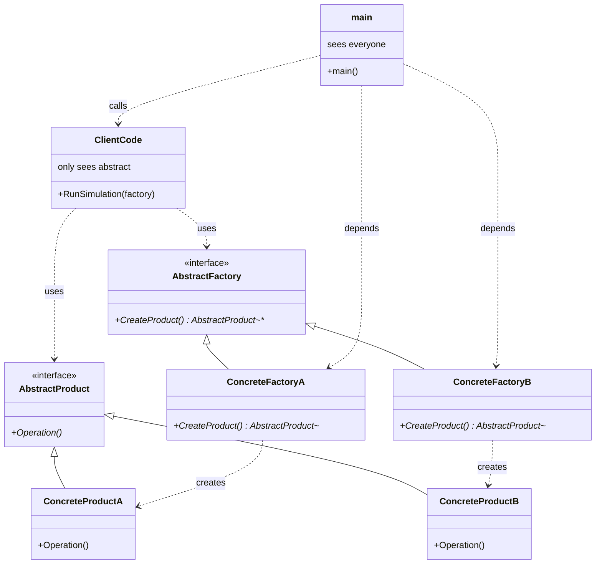

# 工厂模式（Factory Pattern）

> **类型**：概念卡片  
> **领域**: 软件工程 / 面向对象设计  
> **来源**: [小林coding — C++ 深入浅出工厂模式（初识篇）](https://www.cnblogs.com/xiaolincoding/p/11524376.html)、[进阶篇](https://www.cnblogs.com/xiaolincoding/p/11524401.html)；GoF《设计模式：可复用面向对象软件的基础》

---

## 1. 定义

### 一句话定义
> 工厂模式是一种**创建型设计模式**，它将对象的**创建逻辑**与**使用逻辑**解耦，通过专门的工厂类（或工厂方法）来封装（隔离）实例化过程，使客户端无需直接依赖具体类即可获取对象。

### 详细解释

工厂模式的核心思想是**把 new 的操作关进工厂**。在面向对象系统中，直接通过 `new ConcreteClass()` 创建对象会导致调用方与具体类强耦合；当产品类型增加或变更时，调用方代码必须同步修改。工厂模式通过引入一个**工厂层**来**隔离**这种变化。

根据封装程度与抽象层次的不同，工厂模式通常表现为五种形态：

| 形态 | 核心机制 | 扩展方式 | 是否符合开闭原则 |
|------|----------|----------|------------------|
| **简单工厂**（Simple Factory） | 一个工厂类，通过 `switch`/`if-else` 根据参数创建不同产品 | 修改工厂类源码 | ❌ 不符合 |
| **工厂方法**（Factory Method） | 抽象工厂定义接口，每个具体工厂负责创建一种具体产品 | 新增具体工厂类 | ✅ 符合 |
| **抽象工厂**（Abstract Factory） | 一个工厂接口包含多个创建方法，生产**产品族** | 新增具体工厂类 | ✅ 符合 |
| **模板工厂** | 用 C++ 模板参数化抽象产品与具体产品，编译期确定类型 | 无需新增工厂类 | ✅ 符合 |
| **产品注册 + 单例工厂** | 用 `std::map` 注册产品创建器，通过字符串 key 运行时获取 | 注册新产品即可 | ✅ 符合 |

- **简单工厂**是工厂模式家族中最基础的形态，但严格来说**不属于** GoF 23 种经典设计模式，它通过一个集中式的工厂类来创建所有产品，逻辑简单但扩展性差。
- **工厂方法**是 GoF 正式定义的模式：*定义一个用于创建对象的接口，让子类决定实例化哪一个类*，将实例化延迟到子类。
- **抽象工厂**解决的是**产品族**问题：当需要创建一组相互关联或依赖的对象（如 UI 组件库中的 Button + Scrollbar）时，抽象工厂保证同一族产品的兼容性。
- **模板工厂**和**产品注册 + 单例工厂**是 C++ 泛型编程与运行时注册机制对经典工厂模式的工程化改良，前者减少类爆炸，后者实现真正的"新增产品不修改任何已有类"的理想状态。

### 类比
向研一学生解释：想象你去一家连锁餐厅点餐。

- **简单工厂** = 一家小餐馆，只有一个万能厨师。你说"宫保鸡丁"他就做鸡丁，说"鱼香肉丝"他就做肉丝。厨师脑子里记着所有菜谱，新增菜品时厨师必须重新学习（修改工厂类）。
- **工厂方法** = 连锁品牌，总部只规定"每家店必须能做出一道招牌菜"（抽象工厂），但具体怎么做由各分店（具体工厂）自己实现。新增菜品时，开一个新分店即可，老分店完全不受影响。
- **抽象工厂** = 餐厅集团同时经营中餐部和西餐部。中餐工厂做筷子和米饭，西餐工厂做刀叉和面包，保证同一餐区的餐具风格一致（产品族兼容）。
- **产品注册 + 单例工厂** = 美食广场有一个中央厨房管理系统（单例），各摊位（产品注册器）在开业时向系统登记自己的菜单。顾客只需在系统上输入菜名，系统自动分配到对应的摊位制作，新增摊位只需登记，无需改造系统。

---

## 2. 形式化表达

### 核心结构（UML 类关系）


### 角色说明

| 角色                | 含义          | 职责                   |
| ----------------- | ----------- | -------------------- |
| `AbstractFactory` | 抽象工厂 / 工厂接口 | 声明创建产品的接口，稳定调用方依赖    |
| `ConcreteFactory` | 具体工厂        | 实现创建接口，负责实例化特定的具体产品  |
| `AbstractProduct` | 抽象产品        | 定义产品的公共接口，是工厂方法的返回类型 |
| `ConcreteProduct` | 具体产品        | 实现抽象产品接口，被工厂创建的目标对象  |

### 关键代码范式（C++）

```cpp
#include <memory>
#include <iostream>

// 1. 抽象产品（产品模式，虚基类）
class Product {
public:
    virtual void Operation() = 0;
    virtual ~Product() = default;
};

// 2. 具体产品（实现）
class ConcreteProductA : public Product {
public:
    void Operation() override { std::cout << "Product A\n"; }
};

class ConcreteProductB : public Product {
public:
    void Operation() override { std::cout << "Product B\n"; }
};

// 3. 抽象工厂（工厂方法模式，虚基类）
class Factory {
public:
	virtual std::unique_ptr<Product> CreateProduct() = 0;
    virtual ~Factory() = default;
};

// 4. 具体工厂（实现）
class ConcreteFactoryA : public Factory { // 只生产A
public:
	std::unique_ptr<Product> CreateProduct() override {
        return std::make_unique<ConcreteProductA>();
    }
};

class ConcreteFactoryB : public Factory { // 只生产B
public:
	std::unique_ptr<Product> CreateProduct() override {
        return std::make_unique<ConcreteProductB>();
    }
};


// ===== 主代码：只依赖抽象接口 =====
void ClientCode(Factory& factory) {
    auto product = factory.CreateProduct();  // 工厂负责创建
    product->Operation();  // 主代码只使用，不关心具体类型
}

// 运行示例
int main() {
    ConcreteFactoryA factoryA;
    ConcreteFactoryB factoryB;

    ClientCode(factoryA);  // 输出: Product A
    ClientCode(factoryB);  // 输出: Product B

    return 0;
}

```
调用顺序：main-->clientcode-->factory-->(new) product
clientcode只关注拿到对象后怎么用，具体创建哪个对象、怎么创建对象，完全不用管

---

## 3. 知识网络

### 上位概念（更抽象）
- [[创建型模式]] — 工厂模式是 GoF 五大创建型模式之一，解决对象创建问题
- [[面向对象设计原则]] — 依赖倒置原则（DIP）、开闭原则（OCP）是工厂模式的理论基础
- [[软件设计模式]] — 工厂模式是 GoF 23 种经典模式中使用频率最高的模式之一

### 下位概念（更具体）
- [[简单工厂模式]] — 工厂模式的简化形态，非 GoF 正式模式，通过参数集中创建对象
- [[工厂方法模式]] — 将创建职责下沉到子类，每个具体工厂对应一种产品
- [[抽象工厂模式]] — 创建相关对象族，保证产品之间的兼容性
- [[模板工厂]] — 用 C++ 模板消除具体工厂类，编译期参数化产品类型
- [[产品注册模板类 + 单例工厂模板类]] — 用运行时注册表 + 单例实现零修改扩展

### 相关/平行概念
- [[建造者模式]] — 区别：工厂模式关注"创建哪个对象"，建造者关注"如何一步步组装复杂对象"
- [[原型模式]] — 区别：工厂模式通过类实例化创建对象，原型模式通过克隆现有对象创建
- [[单例模式]] — 联系：进阶工厂模式中常将工厂设计为单例，确保全局唯一访问点
- [[策略模式]] — 区别：工厂模式解决对象创建问题，策略模式解决算法替换问题；两者常结合使用（工厂创建策略对象）
- [[依赖注入]] — 联系：现代框架中，DI 容器本质上是一个高度进化的工厂，自动管理对象生命周期

### 文献出处

| 文献 | 观点/用法 |
|------|-----------|
| [[GoF, 《设计模式》]] | 工厂方法：定义创建对象接口，让子类决定实例化哪个类；抽象工厂：提供创建一系列相关对象的接口，无需指定具体类 |
| [[小林coding, 初识篇]] | 以 C++ 多态和继承实现三种经典工厂模式，用鞋厂/生产线类比解释结构差异 |
| [[小林coding, 进阶篇]] | 提出模板工厂与产品注册 + 单例工厂模板类，解决新增产品时"类爆炸"与全局访问问题 |

---

*创建: 2026-06-03*
