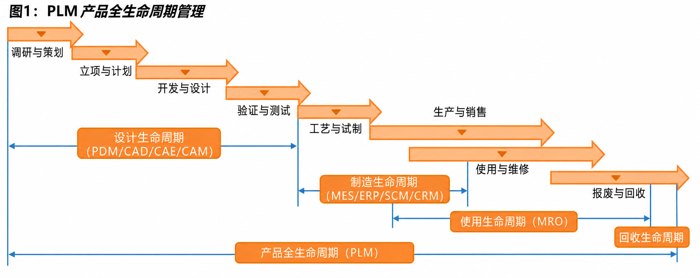

# PLM（产品生命周期管理）

> **类型**：概念卡片
> **领域**: 企业信息化、制造业数字化、产品研发管理
> **来源**: 知乎专栏《PLM系统：初识》、CIMdata、Atlassian PLM指南、智研咨询行业报告

---

## 1. 定义

### 一句话定义
> PLM（Product Lifecycle Management）是一种以产品数据为核心、贯穿产品从概念到报废全生命周期的企业信息化战略，通过整合人员、流程与数据，实现跨部门、跨地域的协同创新与知识沉淀。

### 详细解释
PLM并非单一软件，而是一套涵盖战略、流程、技术与工具的集成体系。其核心目标是建立统一的产品信息源（Single Source of Truth），确保设计、工艺、制造、供应链、售后等全链路数据的一致性与可追溯性。它起源于PDM（产品数据管理），但范围远超PDM，不仅管理图纸与BOM，更覆盖需求管理、项目管理、变更控制、配置管理、合规追溯及与ERP/MES的集成。

### 核心模块（五大方面）
PLM平台通常由以下五大核心模块构成，形成覆盖研发全链路的闭环：

| 模块 | 功能定位 | 关键内容 |
|------|----------|----------|
| **基础数据管理** | 产品信息的唯一源头 | 物料主数据、BOM（物料清单）、CAD图纸、技术文档的版本控制与权限管理 |
| **项目管理** | 研发过程的进度与资源统筹 | 项目计划、任务分解（WBS）、里程碑节点、资源分配、跨部门协同 |
| **工艺管理** | 设计到制造的桥梁 | 工艺路线设计、制造资源规划、作业指导书、工艺BOM（PBOM）生成 |
| **变更管理** | 全链路变更的可控追溯 | 工程变更请求（ECR）、变更指令（ECO）、影响分析、变更审批流程与版本留痕 |
| **配置管理** | 按订单需求快速重组产品 | 产品结构配置、选件组合规则、有效性管理、变量配置与订单BOM生成 |

另有国际贸易中的产品生命周期（PLC）理论，将产品在国际贸易中的动态格局分为“开发、引入、发展、成熟、衰退”五个阶段。
### 类比
向研一学生解释：PLM好比产品的"全病程电子病历"。从出生（概念立项）到成长（设计制造）到衰老（维护优化）到死亡（退役回收），所有"体检报告"（设计图纸）、"手术记录"（变更历史）、"用药清单"（BOM）都被集中存档，任何医生（工程师）在任何时间、任何地点都能调阅最新档案，避免重复检查、误诊或用药冲突。

---

## 2. 发展历程

PLM的演进与CAD、PDM的发展紧密交织，大致经历了三个时代：

### 2.1 CAD时代（1970s—1980s）：以CAD为中心的起源
上世纪70年代，三维CAD开始在大型企业中广泛应用，但**尚无产品数据管理（PDM）的概念**。各CAD厂商（如SDRC、达索）仅在自身CAD系统中嵌入数据管理模块，用于解决图纸的集中存储与快速查询问题。此时的数据管理存在明显局限：只能管理单一CAD格式的数据，既无法实现跨部门流程管控，也无法与外部系统交互。然而，这一阶段奠定了PLM的原始需求——**正是CAD的大量应用，使企业认识到产品数据管理的重要性**，PLM本质上可视为对CAD的集成延伸。

### 2.2 PDM时代（1990s）：独立化与百花齐放
随着企业信息化理念进步，CAD内置的数据管理功能已无法满足需求，**独立于CAD之外的PDM系统**应运而生。90年代属于百花齐放阶段，形成两大流派：
- **"CAD+PDM"集成模式**：以UGS、SDRC、CV为代表，将PDM与自家CAD深度绑定；
- **独立PDM产品模式**：以IBM、惠普、MatrixOne、Agile、Smarteam为代表，提供跨CAD平台的通用数据管理。

90年代中期，SDRC凭借I-DEAS与Metaphase称霸全球汽车制造业；90年代后期则掀起一波收购狂潮，小厂商退出，巨头格局初现。

### 2.3 PLM时代（2000s至今）：平台化与生态整合
21世纪初，CIMdata提出cPDM概念，PLM从单纯的"数据管理"升级为"全生命周期战略"。随后市场经历大洗牌：
- **PTC** 收购Arbortext，强化技术出版与内容管理；
- **达索** 收购MatrixOne，扩展协同平台能力；
- **西门子** 收购UGS，奠定Teamcenter基础；
- **甲骨文** 收购Agile Software，切入PLM领域。

至此，全球PLM市场形成**西门子（Teamcenter）、达索（ENOVIA）、PTC（Windchill）三足鼎立**的格局，Autodesk亦凭借CAD优势成为有力竞争者。近年来，PLM正向SaaS订阅模式、数字线程（Digital Thread）、数字孪生（Digital Twin）及AI/ML深度融合演进。

---

## 3. 市场分类

当前市场上的PLM供应商，依据技术基因与商业路径，可分为三大阵营：

### 3.1 CAD系PLM：以CAD为技术根基向上延伸
这类厂商由CAD工具起家，凭借深厚的几何建模技术与庞大的工程师客户群，将PLM作为CAD的集成延伸。**三大CAD国际巨头（PTC、达索、西门子）持续领跑PLM行业**，占据全球主要市场份额。其核心逻辑是：设计是研发的源头，掌握CAD即掌握数据入口。

| 厂商 | 核心PLM平台 | 关联CAD工具 |
|------|-------------|-------------|
| 西门子 | Teamcenter | NX / Solid Edge |
| 达索系统 | ENOVIA / 3DEXPERIENCE | CATIA / SOLIDWORKS |
| PTC | Windchill | Creo |
| Autodesk | Fusion Lifecycle | AutoCAD / Inventor / Fusion 360 |

### 3.2 PDM系PLM：以独立数据管理为核心
这类厂商专注于产品数据与流程管理本身，不绑定特定CAD品牌，强调跨平台兼容与灵活的流程定制。在国内市场，本土PDM厂商长期深耕机械、电子领域，呈现行业离散型特征。

| 代表厂商 | 特点 |
|----------|------|
| 北京艾克斯特 | 聚焦机械装备行业PDM/PLM |
| 清软英泰 | 侧重流程型制造业 |
| 上海思普 | 提供独立PDM平台 |
| 武汉开目 | 工艺管理与PDM结合 |

### 3.3 ERP系PLM：以资源管理为底座向研发端扩展
ERP厂商凭借良好的企业客户群与组织协同能力，向PLM领域渗透，试图打通"研发—制造—运营"全链条。由于ERP与PLM之间不存在难以逾越的技术壁垒，这一路径具有天然合理性。

| 厂商 | 进入方式 | 代表产品 |
|------|----------|----------|
| SAP | 自研PLM模块 | SAP PLM |
| Oracle | 2007年收购Agile Software | Oracle Agile PLM |
| 用友 | 2009年收购重庆迈特科技 | 用友PLM |
| 金蝶 | 2002年收购广州普维科技 | 金蝶PLM |

---

## 4. 数学表达

### 核心公式
PLM 本身为管理方法论，无普适性数学公式。其效能可通过以下关键指标量化：

$$
\text{研发效率提升率} = \frac{T_{\text{传统}} - T_{\text{PLM}}}{T_{\text{传统}}} \times 100\%
$$

$$
\text{BOM 准确率} = \frac{N_{\text{正确BOM}}}{N_{\text{总BOM}}} \times 100\%
$$

$$
\text{工程变更周期} = T_{\text{ECR提出}} \to T_{\text{ECO关闭}}
$$

### 符号说明
| 符号 | 含义 | 单位 |
|------|------|------|
| $T_{\text{传统}}$ | 传统研发模式下的平均上市时间 | 天/月 |
| $T_{\text{PLM}}$ | 实施PLM后的平均上市时间 | 天/月 |
| $N_{\text{正确BOM}}$ | 无差错的物料清单数量 | 个 |
| $N_{\text{总BOM}}$ | 物料清单总数 | 个 |
| ECR | 工程变更请求（Engineering Change Request） | — |
| ECO | 工程变更指令（Engineering Change Order） | — |

### 推导或离散形式
PLM 通过并行工程（Concurrent Engineering）压缩串行等待时间。设传统串行流程总时长为 $\sum_{i=1}^{n} t_i$，引入PLM协同后，设计、工艺、制造评审可部分重叠，实际周期 $T_{\text{实际}} = \max(t_i) + \Delta t_{\text{协同}}$，其中 $\Delta t_{\text{协同}}$ 为协同开销，通常 $\Delta t_{\text{协同}} \ll \sum t_i - \max(t_i)$。

---

## 5. 知识网络

### 上位概念（更抽象）
- [[企业信息化战略]] — PLM 是企业数字化转型的核心支柱之一
- [[系统工程]] — 从全局视角管理复杂产品全生命周期

### 下位概念（更具体）
- [[PDM（产品数据管理）]] — PLM 的技术基础，聚焦图纸与文档管理
- [[BOM管理]] — 物料清单的创建、展开、校验与版本控制
- [[工程变更管理（ECM）]] — 变更请求、审批、实施与影响分析
- [[配置管理]] — 按订单需求组合产品结构与选件

### 相关/平行概念
- [[ERP（企业资源计划）]] — 区别：ERP聚焦生产资源（采购、生产、财务），PLM聚焦研发数据（设计、工艺、变更）；联系：PLM提供BOM源头数据，ERP承接生产执行
- [[MES（制造执行系统）]] — 区别：MES管控车间层生产调度，PLM管控研发层数据与流程；联系：PLM将工艺路线与作业指导书下发至MES
- [[数字孪生（Digital Twin）]] — 区别：数字孪生是物理产品的实时虚拟镜像，PLM是产品数据的静态与动态管理体系；联系：PLM为数字孪生提供全生命周期数据底座

### 文献出处

| 文献 | 观点/用法 |
| ----- | ----- |
| [[CIMdata]] | PLM是一种企业信息化的商业战略，实施一整套业务解决方案，把人、过程和信息有效集成，遍历产品从概念到报废的全生命周期 |
| [[Aberdeen Group]] | PLM是覆盖产品从诞生到消亡全过程的开放互操作应用方案，核心是建立系统化的中心产品数据知识库 |
| [[Atlassian PLM指南]] | PLM打通产品从初始概念到淘汰全生命周期内的团队、数据与业务流程，形成单一事实来源 |
| [[智研咨询]] | PLM产品主要可分为CAx、cPDm和数字化制造三类，供应商来源可分为PDM/CAD工具类软件和ERP软件两类 |

---

*创建: 2026-07-15*
