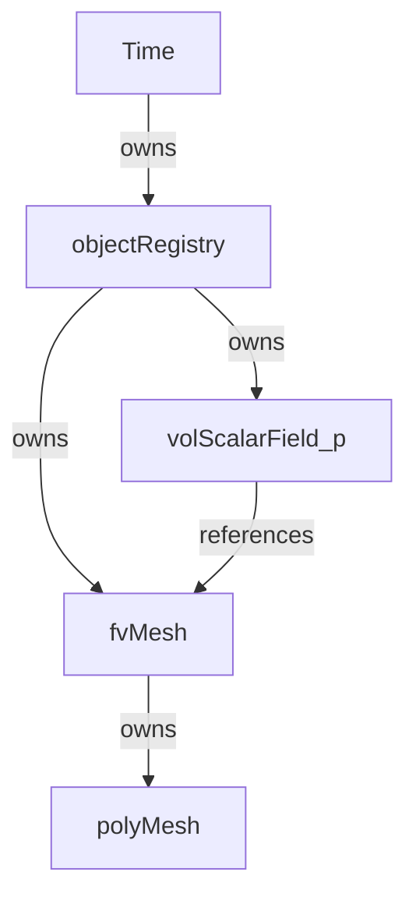
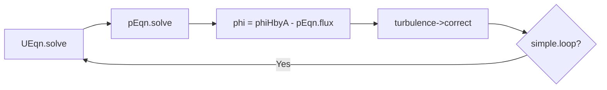

# 开源CFD/CSD求解器源码阅读指南：AI Agent 辅助的 30 天手把手上手流程

> **适用对象**：OpenFOAM、SU2、CalculiX、Code_Aster 等大型开源科学计算软件  
> **核心方法**：「宏观 → 中观 → 微观 → 实战」四阶段递进，每天 1.5–2 小时，结合 AI Agent 进行「结构化提问 → 代码定位 → 笔记固化 → 验证闭环」  
> **输出要求**：每日产生一份标准 Markdown 笔记，最终形成个人可检索的「源码知识库」

---

## 一、前置准备（第 0 天）

### 1.1 环境检查清单
| 项目 | 要求 | 验证命令 |
|------|------|----------|
| 源码版本 | 确定 Git tag / commit hash | `git log --oneline -5` |
| 编译环境 | 能完整编译通过 | 按官方教程编译一次 |
| IDE/编辑器 | 支持跳转（VSCode + clangd / Vim + ctags） | 能 Ctrl+Click 跳转到定义 |
| 调试器 | GDB/LLDB 可用 | `gdb --version` |
| AI 工具 | 准备好本指南的提问模板 | 复制到剪贴板 |

### 1.2 目录约定
```
~/code-reading/
├── notes/                    # 每日笔记（Markdown）
├── diagrams/                 # 自绘或 AI 生成的架构图
├── snippets/                 # 关键代码片段（带注释）
├── traces/                   # 调试日志与调用栈
└── questions.md              # 待问 AI 的问题清单（动态更新）
```

### 1.3 向 AI 提出的第一个问题（启动问题）
```
我正在阅读 [OpenFOAM v2312 / SU2 v8 / CalculiX 2.21 / Code_Aster 16.x] 的源码，
目的是理解其 [空间离散 / 时间推进 / 并行架构 / 湍流模型] 的实现。
请为我生成一份该软件的「顶层模块依赖图」（Mermaid 格式），
并列出阅读源码时最关键的 10 个入口文件（main 或顶级类）。
```
**记录内容**：将 AI 返回的 Mermaid 图保存到 `diagrams/00-overview.md`，并标注版本号。

---

## 二、第一阶段：环境搭建与架构概览（Day 1–3）

> **目标**：能编译、能运行、能定位文件；建立「地图感」。

### Day 1：目录结构与编译系统

#### 今日任务
1. 克隆源码，检出特定版本，完成首次编译。
2. 用 `tree -L 2` 或 `find . -maxdepth 2 -type d` 列出顶级目录。
3. 找到官方文档中的 "Source Code Guide" 或 "Developer Guide"。

#### 向 AI 提问（按顺序）
```
Q1: 请解释 [软件名] 源码根目录下每个子目录的职责，
    用表格形式输出：目录 | 职责 | 关键子目录 | 类比（如 OpenFOAM 的 src/finiteVolume 对应 FVM 框架）。

Q2: 这个项目的构建系统是如何工作的？
    - 顶层构建脚本是什么？（如 Allwmake、CMakeLists.txt、Makefile）
    - 模块间依赖如何声明？
    - 编译一个自定义求解器的最小命令是什么？

Q3: 请追踪一个标准求解器（如 simpleFoam / euler / ccx）的编译过程，
    告诉我它链接了哪些核心库，按依赖顺序列出。
```

#### 笔记模板（`notes/01-directory-and-build.md`）
```markdown
# Day 1: 目录结构与编译系统

## 版本信息
- 软件: OpenFOAM v2312
- Commit: abc1234
- 编译器: GCC 11.3

## 目录职责表
| 目录 | 职责 | 关键文件 |
|------|------|----------|
| src/OpenFOAM | 核心库：字段、网格、矩阵 | Field.H, fvMatrix.H |
| ... | ... | ... |

## 构建系统理解
- 顶层脚本: `Allwmake`（调用 wmake 递归编译）
- 库依赖链: libOpenFOAM → libfiniteVolume → libincompressibleTurbulenceModels → simpleFoam
- 编译自定义求解器: `wmake`（自动生成 Make/files、Make/options）

## 关键发现
- [ ] 发现编译系统使用 wmake（OpenFOAM 专用）
- [ ] 发现每个库有独立的 Make/files 和 Make/options

## 待澄清
- [ ] wmake 与 standard make 的区别？
```

---

### Day 2：运行一个标准算例，理解输入输出

#### 今日任务
1. 运行官方 Tutorial 中最简单的算例（如 cavity、flat plate）。
2. 观察目录结构：`0/`、`constant/`、`system/`（OpenFOAM）或 `.cfg`、`.su2`（SU2）。
3. 用 `strace -e openat` 或日志追踪程序读取了哪些文件。

#### 向 AI 提问
```
Q1: 请解释 [算例名] 的目录结构，每个文件/文件夹在程序启动时被哪个函数读取？
    请给出「文件路径 → 读取函数 → 数据结构」的映射表。

Q2: 程序启动后，从 main() 到开始第一次迭代的完整调用链是什么？
    请用缩进文本或 Mermaid sequenceDiagram 展示。

Q3: 算例中的字典文件（如 fvSchemes、controlDict）是如何被解析的？
    解析器类在哪里定义？
```

#### 笔记模板（`notes/02-case-io.md`）
```markdown
# Day 2: 算例输入输出与启动流程

## 算例路径
- tutorials/incompressible/icoFoam/cavity

## 文件 → 函数 → 数据结构映射
| 文件 | 读取函数 | 目标类/变量 | 源码位置 |
|------|----------|-------------|----------|
| constant/polyMesh/points | polyMesh::readPoints() | pointField | src/OpenFOAM/meshes/polyMesh/polyMesh.C |
| system/controlDict | Time::readDict() | dictionary | src/OpenFOAM/db/Time/Time.C |

## 启动调用链（简化）
main()
  └── Foam::Time::Time()
        └── Foam::dictionary::dictionary()
  └── Foam::fvMesh::fvMesh()
        └── Foam::polyMesh::polyMesh()
  └── createFields.H
        └── volScalarField p(U.objectRegistry(), ...)
  └── while (runTime.loop())
        └── solve(UEqn)

## 关键发现
- 字典解析器在 src/OpenFOAM/db/dictionary/ 目录下
- 网格在 Time 之后创建，依赖 objectRegistry
```

---

### Day 3：对象注册表与内存管理模型

#### 今日任务
1. 理解该软件的「对象生命周期管理」哲学（OpenFOAM 的 objectRegistry / autoPtr；SU2 的 CConfig + CSolver 层级）。
2. 找到内存分配的关键类（如 fvMesh、volScalarField、CGeometry）。
3. 用 `valgrind --tool=massif` 或简单的 `new/delete` 追踪观察内存峰值。

#### 向 AI 提问
```
Q1: [软件名] 中对象注册表（Object Registry / Container）的设计意图是什么？
    请解释 autoPtr、tmp、refPtr 等智能指针的区别，以及为什么需要它们。

Q2: 请绘制一个「网格 → 场变量 → 方程 → 求解器」的 ownership 关系图，
    说明谁拥有谁、谁只是引用。

Q3: 如果我需要在运行时动态创建一个新的场变量（如自定义湍流场），
    应该调用哪个类的哪个方法？请给出代码片段。
```

#### 笔记模板（`notes/03-object-registry.md`）
```markdown
# Day 3: 对象注册表与内存管理

## 核心机制
- objectRegistry: 树形数据库，存储所有 IOobject
- autoPtr: 独占所有权，转移语义
- tmp<T>: 用于返回临时对象，避免深拷贝

## Ownership 图（Mermaid）


## 关键代码片段
```cpp
// OpenFOAM: 动态创建场
volScalarField myField(
    IOobject("myField", runTime.timeName(), mesh, IOobject::NO_READ, IOobject::AUTO_WRITE),
    dimensionedScalar("zero", dimLength, 0.0)
);
```

---

## 三、第二阶段：核心架构与数据流（Day 4–10）

> **目标**：能画出「类图」和「数据流图」；理解「从物理问题到线性系统」的完整路径。

### Day 4：入口函数与主循环解构

#### 今日任务
1. 找到求解器的 `main()`（如 `applications/solvers/incompressible/simpleFoam/simpleFoam.C`）。
2. 逐行阅读 main，标记出：初始化 → 前处理 → 时间/迭代循环 → 后处理 → 退出。
3. 用 GDB 在 main 打断点，单步跟踪一次循环。

#### 向 AI 提问
```
Q1: 请逐行解释 [求解器名] 的 main() 函数，对每一行给出：
    - 该行代码的「高层意图」（如：创建速度场）
    - 调用的关键类/函数名
    - 对应的源码文件路径

Q2: 主循环中的「时间步推进」与「方程求解」是如何解耦的？
    如果是稳态求解器，伪时间步的作用是什么？

Q3: 请提取 main() 中所有 #include 的头文件，按「系统级 / 核心库 / 物理模型 / 本地" 分类，
    并解释为什么需要每一类。
```

#### 笔记模板（`notes/04-main-deconstruction.md`）
```markdown
# Day 4: 入口函数与主循环

## 文件路径
- applications/solvers/incompressible/simpleFoam/simpleFoam.C

## 主循环结构（伪代码）
```cpp
int main(int argc, char *argv[]) {
    // 1. 初始化环境
    #include "setRootCaseLists.H"      // 解析命令行
    #include "createTime.H"            // 创建 Time 对象
    #include "createMesh.H"            // 创建 fvMesh
    #include "createFields.H"          // 创建 U, p, 湍流模型

    // 2. 前处理
    turbulence->validate();              // 验证湍流模型

    // 3. 迭代循环
    while (simple.loop()) {            // 伪时间步/ SIMPLE 迭代
        // 3.1 动量预测
        UEqn = fvm::div(phi, U) + turbulence->divDevReff(U) ...
        UEqn.solve();

        // 3.2 压力修正（泊松方程）
        pEqn = fvm::laplacian(rAtU(), p) == fvc::div(phiHbyA);
        pEqn.solve();

        // 3.3 通量修正与连续性检查
        phi = phiHbyA - pEqn.flux();
        #include "continuityErrs.H"

        // 3.4 湍流模型更新
        turbulence->correct();
    }
    return 0;
}

## 调试记录
- GDB 断点: b simpleFoam.C:68
- 发现 simple.loop() 内部检查残差收敛
```

---

### Day 5：核心类与继承体系

#### 今日任务
1. 找到 3-5 个最顶层的基类（如 `fvMatrix`、`lduMatrix`、`CVariable`、`CGeometry`）。
2. 用 Doxygen 或 `grep -r "class.*:"` 画出继承树（前 3 层）。
3. 理解「接口类」与「实现类」的分工。

#### 向 AI 提问
Q1: 请列出 [软件名] 中「离散化系统」最核心的 5 个基类，
    给出：类名 | 文件路径 | 设计意图 | 关键虚函数。

Q2: 请绘制这 5 个类的继承关系图（Mermaid classDiagram），
    标注每个类最关键的 3 个成员变量和 3 个成员函数。

Q3: 「多态」在这个项目中被用来解决什么问题？
    举一个具体例子：基类指针如何调用到具体实现？
```

#### 笔记模板（`notes/05-class-hierarchy.md`）
```markdown
# Day 5: 核心类与继承体系

## 顶层基类表
| 类名 | 文件 | 意图 | 关键虚函数 |
|------|------|------|------------|
| lduMatrix | src/OpenFOAM/matrices/lduMatrix/lduMatrix.H | 稀疏矩阵基类 | solve(), Amul(), Tmul() |
| fvMatrix | src/finiteVolume/fvMatrices/fvMatrix/fvMatrix.H | 有限体积离散矩阵 | source(), boundaryManipulate() |
| ... | ... | ... | ... |

## 继承图（Mermaid）
```mermaid
classDiagram
    lduMatrix <|-- fvMatrix
    fvMatrix <|-- fvScalarMatrix
    fvMatrix <|-- fvVectorMatrix
    fvMatrix : +Field<Type> psi_
    fvMatrix : +solve()
    lduMatrix : +PtrList<lduInterface> interfaces_

## 多态实例
- `fvMatrix::solve()` 内部调用 `lduMatrix::solverPerformance solve(...)`
- 实际求解器（如 GAMG、PBiCG）通过 `fvMatrixSolver` 注册表自动选择
```

---

### Day 6：网格数据结构

#### 今日任务
1. 理解网格的「拓扑 + 几何」分离设计（点、面、单元、边界）。
2. 找到邻接表存储方式（如 OpenFOAM 的 `owner`/`neighbour` 数组）。
3. 写一个 5 行的小程序打印某个单元的邻接单元 ID。

#### 向 AI 提问
```
Q1: 请解释 [软件名] 的网格数据结构：
    - 点、面、单元、边界的存储容器分别是什么类？
    - 邻接关系（cell-cell, cell-face, face-point）是如何存储的？
    - 边界面的存储与内部面有何不同？

Q2: 请给出一段代码片段，展示如何遍历：
    a) 一个单元的所有面
    b) 一个面的所有邻接单元
    c) 一个边界 patch 的所有面

Q3: 并行分区时，网格是如何切分的？
    重叠区（overlap / halo / ghost cells）在哪个类中管理？
```

#### 笔记模板（`notes/06-mesh-data-structure.md`）
```markdown
# Day 6: 网格数据结构

## 核心类
- polyMesh: 拓扑（owner, neighbour, points, faces, boundaryMesh）
- fvMesh: 在 polyMesh 上添加 FVM 几何量（Sf, V, Cf）
- primitiveMesh: 底层拓扑计算（单元中心、面中心等）

## 邻接关系存储
- owner[faceI]: 该面归属的 owner 单元 ID
- neighbour[faceI]: 该面另一侧的 neighbour 单元 ID（边界面为 -1）
- cellCells()[cellI]: 通过面邻接的单元列表（间接寻址）

## 遍历代码片段
```cpp
// 遍历单元 cellI 的所有面
const cell& c = mesh.cells()[cellI];
forAll(c, i) {
    label faceI = c[i];
    const face& f = mesh.faces()[faceI];
    // ...
}

## 并行网格
- lduMesh / lduInterface: 管理 processor boundaries
- 通信模式: initEvaluate() / evaluate() 用于非阻塞交换
```

---

### Day 7：场变量与离散化框架

#### 今日任务
1. 理解 `volScalarField`、`surfaceScalarField` 的模板层次（`Field → GeometricField → fvPatchField`）。
2. 找到一个离散算子的实现（如 `fvm::laplacian` 或 `fvc::div`）。
3. 手动推导一个简单算子（如 2D 扩散项）的代码实现与数学公式对应关系。

#### 向 AI 提问
```
Q1: 请解释 GeometricField 的三层模板参数：Type, PatchField, GeoMesh。
    为什么需要这三层？举例说明 volScalarField 是如何实例化的。

Q2: 请深入分析 fvm::laplacian(gamma, T) 的实现：
    - 最终生成矩阵的函数在哪个文件？
    - 内部面、边界面的贡献分别在哪里组装？
    - 请给出从数学公式到代码的逐行映射。

Q3: fvm:: 与 fvc:: 的命名含义是什么？
    它们返回的对象类型有何本质区别（隐式 vs 显式）？
```

#### 笔记模板（`notes/07-field-and-discretization.md`）
```markdown
# Day 7: 场变量与离散化框架

## GeometricField 模板层次
Field<Type>                          // 裸数组，无拓扑
  └── DimensionedField<Type, GeoMesh>  // 带量纲和网格指针
        └── GeometricField<Type, PatchField, GeoMesh>  // 带边界条件
              └── volScalarField (typedef)

## fvm::laplacian 追踪
- 入口: src/finiteVolume/fvm/fvmLaplacian.C
- 内部面: gaussLaplacianScheme.C 中 faceFlux*magSf*deltaCoeff
- 边界: 通过 patchField 的 updateCoeffs() / manipulateMatrix() 注入

## 公式映射
数学: ∫ ∇·(γ∇T) dV ≈ Σ γ_f S_f · (∇T)_f
代码:
```cpp
// 内部面
gamma*magSf()*faceGrad  // gamma_f * |S_f| * (T_N - T_P)/|d|
// 边界
patchField.updateCoeffs()  // 修改边界矩阵行
```

---

### Day 8：线性系统求解器接口

#### 今日任务
1. 找到矩阵组装完成后，进入求解器的入口（`fvMatrix::solve()` → `lduMatrix::solverPerformance`）。
2. 理解求解器选择机制（字典文件 → runTime selection → 具体 solver 类）。
3. 对比默认求解器（GAMG / PBiCGStab / GMRES）的参数设置。

#### 向 AI 提问
```
Q1: 请追踪从 "UEqn.solve()" 到实际线性求解器（如 GAMG、PBiCGStab）的完整调用链，
    列出经过的每个类/函数及其文件路径。

Q2: 「运行时选择机制」（runTimeSelection / factory pattern）是如何实现的？
    请解释 addToRunTimeSelectionTable 宏的工作原理。

Q3: 预处理器（preconditioner）与平滑器（smoother）在这个框架中是如何被配置和调用的？
    请画出 GAMG 的 V-cycle 在代码中的体现。
```

#### 笔记模板（`notes/08-linear-solver.md`）
```markdown
# Day 8: 线性系统求解器接口

## 调用链
fvMatrix::solve()
  └── lduMatrix::solverPerformance solve(...)
        └── lduSolver::New(matrix, interfaceFieldPtrs)  // 工厂模式
              └── GAMG::solve() / PBiCGStab::solve()

## 运行时选择机制
- 宏: `addToRunTimeSelectionTable(lduMatrix, GAMG, symMatrix)`
- 原理: 静态初始化时注册到 HashTable，键为字典中的 "solver" 字段

## GAMG V-cycle 代码体现
- GAMG::solve() → Vcycle::cycle()
- restrict() → coarse solve → prolongate() → smooth()
- 在 GAMGAgglomeration 中构建粗网格
```

---

### Day 9：边界条件框架

#### 今日任务
1. 理解 `fvPatchField` 的继承体系：fixedValue、zeroGradient、inletOutlet、wallFunction。
2. 找到边界条件对矩阵和右端项的修改位置（`manipulateMatrix`、`updateCoeffs`、`evaluate`）。
3. 尝试修改一个边界条件，观察残差变化。

#### 向 AI 提问
```
Q1: 请解释边界条件在 [软件名] 中的实现层次：
    - 顶层基类是什么？
    - 边界条件如何「影响」内部计算（矩阵行修改 vs 通量修正 vs 场值覆盖）？
    - 请用表格列出 5 种常见边界条件的实现文件和修改方式。

Q2: 如果我需要实现一个「随时间变化的速度入口」，
    应该继承哪个类？需要重写哪些虚函数？
    请给出最小可编译代码框架。

Q3: 边界条件与湍流模型（如 wallFunction）是如何耦合的？
     wallFunction 是在边界条件内部调用，还是湍流模型内部调用？
```

#### 笔记模板（`notes/09-boundary-conditions.md`）
```markdown
# Day 9: 边界条件框架

## 核心继承链
```
fvPatchField<Type>
  ├── fixedValueFvPatchField          // 直接覆盖值
  ├── fixedGradientFvPatchField       // 零梯度/固定梯度
  ├── mixedFvPatchField               // 混合（Robin）
  └── inletOutletFvPatchField         // 方向相关
```

## 边界条件影响内部计算的三种方式
| 方式 | 适用场景 | 代码位置 | 示例 |
|------|----------|----------|------|
| 矩阵行修改 | Dirichlet | fvMatrix::setValues() | fixedValue |
| 源项修正 | Neumann | boundaryManipulate() | fixedGradient |
| 通量修正 | 耦合边界 | updateCoeffs() | processor |

## 自定义边界条件框架（最小代码）
```cpp
class myInletFvPatchVectorField : public fixedValueFvPatchVectorField {
    // 重写 updateCoeffs() 实现随时间变化
};
```
```

---

### Day 10：时间推进与迭代控制

#### 今日任务
1. 理解 `Time` 类或 `CIteration` 类的职责。
2. 找到 CFL 数计算、时间步长调整的代码。
3. 如果是稳态求解器，理解 SIMPLE / PISO 算法的外迭代与内迭代。

#### 向 AI 提问
```
Q1: 请解释时间类（Time / CIteration）的职责边界：
    - 它管理物理时间还是伪时间？
    - 时间步长调整（CFL 限制）是在哪个函数中完成的？
    - 输出控制（writeInterval）是如何触发的？

Q2: 对于 SIMPLE 算法，请绘制「速度预测 → 压力修正 → 通量修正 → 湍流更新」的循环图，
    并标注每一步对应的源码文件和关键变量名。

Q3: 残差收敛判断的逻辑在哪里？
    是判断单个方程的残差，还是整体残差？是否可以自定义收敛准则？
```

#### 笔记模板（`notes/10-time-and-iteration.md`）
```markdown
# Day 10: 时间推进与迭代控制

## Time 类职责
- 物理时间步管理（deltaT, endTime）
- 输出数据库（objectRegistry 的根节点）
- 触发 write() 事件

## SIMPLE 循环源码映射

- UEqn: applications/solvers/incompressible/simpleFoam/UEqn.H
- pEqn: pEqn.H
- correct: turbulence->correct() in src/TurbulenceModels/

## 收敛判断
- simple.loop(): 检查 initialResidual < tolerance（fvSolution 中定义）
- 可自定义: 继承 convergenceCriteria（较复杂，通常改字典即可）
```

---

## 四、第三阶段：算法深入（Day 11–20）

> **目标**：能逐行解释一个具体物理模型的实现，能定位数值方法相关的 bug。

### Day 11–12：对流项与扩散项实现

#### 今日任务
- 精读 `gaussConvectionScheme` 或 `CCenteredBase`（SU2）。
- 对比一阶迎风格式与二阶格式的代码差异（限制器在哪里引入）。
- 手动验证一个 1D 算例的矩阵元素。

#### 向 AI 提问模板
```
Q1: 请详细解释对流项 div(phi, U) 的离散实现：
    - 通量 phi 是如何计算的？
    - 迎风格式（Upwind）与中心格式（Linear）在代码中如何区分？
    - 限制器（Limiter）是在哪个函数中施加的？

Q2: 请给出 1D 三单元网格下，div(phi, T) 的矩阵形式（假设 phi=1, 迎风格式），
    并指出代码中对应填充矩阵元素的位置。

Q3: 扩散项 laplacian 的跨边界处理（非正交修正）在哪个类中实现？
    非正交修正迭代次数如何控制？
```

#### 笔记模板（`notes/11-convection-diffusion.md`）
```markdown
# Day 11-12: 对流与扩散项

## 对流项实现
- 入口: gaussConvectionScheme.C
- 通量 phi: surfaceScalarField，由 fvc::interpolate(U) & Sf 计算
- 格式选择: 通过 fvSchemes 字典，运行时选择表加载

## 1D 矩阵验证
网格: |---|---|---|
单元:  0   1   2
phi = 1 (从左向右)
Upwind 矩阵第 1 行: a_11 = 1, a_12 = -1, 其余 0
代码对应: gaussUpwindDivScheme.C 中 faceFlux 符号判断

## 非正交修正
- 类: nonOrthogonalSolutionControl / laplacianScheme
- 迭代: nNonOrthogonalCorrectors in fvSolution
```

---

### Day 13–14：梯度计算与限制器

#### 今日任务
- 理解 `fv::gaussGrad`、`leastSquaresGrad`。
- 找到梯度限制器（Venkatakrishnan / Barth-Jespersen）的代码。
- 观察梯度限制对激波捕捉的影响。

#### 向 AI 提问模板
```
Q1: 请解释梯度计算的三种方法（Gauss 点定理 / Least Squares / Green-Gauss）
    在代码中的实现位置，以及各自的适用场景。

Q2: 梯度限制器（limiter）的数学公式是什么？
    请给出代码中计算 limiter 的循环结构，并解释为什么需要 face-based 和 cell-based 两种遍历。

Q3: 在 [软件名] 中，如果我想关闭梯度限制器观察影响，
    应该修改哪个字典的哪个字段？是否需要重编译？
```

---

### Day 15–16：湍流模型实现

#### 今日任务
- 找到 RANS 模型（k-ε / k-ω / SA）的源码。
- 理解「湍流模型类」与「边界条件 wallFunction」的交互。
- 对比 DES/LES 模型在代码结构上的差异（额外方程？过滤函数？）。

#### 向 AI 提问模板
```
Q1: 请解释湍流模型的继承架构：
    - turbulenceModel → RASModel → kEpsilon 的继承链
    - correct() 函数在每个层级分别做了什么？
    - 湍流粘度 nut 是如何被求解器访问的？

Q2: 请追踪 k-ε 模型的两个输运方程在代码中的实现：
    - 哪个文件定义了 k 方程？哪个文件定义了 epsilon 方程？
    - 源项（生成项、耗散项、壁面衰减）分别在哪里计算？

Q3: 壁面函数（wallFunction）是如何修改近壁面单元的湍流变量的？
    请给出从壁面距离计算到 nut 修正的调用链。
```

---

### Day 17–18：并行计算（MPI / OpenMP）

#### 今日任务
- 找到 `Pstream`、`MPI_Comm` 或 `CConfig` 中的并行配置。
- 理解「域分解」与「通信模式」（非阻塞交换、全局归约）。
- 找一个并行相关的类（如 `processorFvPatchField`、`CGeometry` 的 MPI 部分）。

#### 向 AI 提问模板
```
Q1: 请解释该软件的并行架构：
    - 基于 MPI 还是 OpenMP 或混合？
    - 网格分解是在哪个阶段完成的？（前处理 / 运行时）
    - 进程间通信的抽象层是什么类？

Q2: 请追踪一次场变量交换（如 processor 边界更新）的完整流程：
    - 哪个函数发起发送？
    - 哪个函数接收并组装？
    - 是阻塞通信还是非阻塞通信？

Q3: 全局操作（如计算总力、总质量流量）是如何实现的？
    请找到 MPI_Allreduce 或等效调用的位置。
```

---

### Day 19–20：特定物理模型（选做）

根据你阅读的软件选择：
- **OpenFOAM**: 多相流（interFoam）、燃烧（reactingFoam）、动网格（dynamicFvMesh）
- **SU2**: 伴随方程（AD / discrete adjoint）、流体-结构耦合（FSI）
- **CalculiX**: 材料非线性、接触算法
- **Code_Aster**: 热-力耦合、子结构分析

#### 向 AI 提问模板
```
Q1: 请解释 [特定模型] 在代码中的实现架构：
    - 新增了哪些类？继承了哪些基类？
    - 与标准求解器相比，主循环中多了哪些步骤？

Q2: 该模型的关键数值难点（如界面捕捉、接触检测）在代码中是如何处理的？
    请定位到核心算法函数。

Q3: 如果我想在这个模型中加入一个简化假设（如忽略某一项），
    最少需要修改哪几个文件？
```

---

## 五、第四阶段：扩展与修改实战（Day 21–30）

> **目标**：能独立修改源码、添加新功能、调试并验证结果。

### Day 21–22：编写自定义边界条件

#### 今日任务
- 复制一个现有边界条件，重命名为 `myCustomBC`。
- 修改其 `updateCoeffs()` 实现自定义逻辑（如正弦速度入口）。
- 编译、链接到现有求解器，运行算例验证。

#### 向 AI 提问模板
```
Q1: 请给我一份「自定义边界条件」的完整开发清单：
    - 需要创建哪些文件？（.H / .C / 可能的模板特化）
    - 需要在哪个 Make/files 中注册？
    - 编译命令是什么？

Q2: 我的边界条件编译通过了，但运行时没有生效，可能的原因有哪些？
    请给出排查清单（字典拼写、运行时选择表、链接路径等）。

Q3: 请帮我检查这段自定义边界条件代码是否有内存泄漏或线程安全问题。
```

---

### Day 23–24：编写自定义求解器

#### 今日任务
- 复制 `icoFoam`，重命名为 `mySolver`。
- 添加一个新方程（如被动标量输运方程）。
- 修改 `createFields.H`，添加新场变量。
- 编译并运行验证。

#### 向 AI 提问模板
```
Q1: 请解释「自定义求解器」的最小文件集合：
    - 哪些文件可以直接复制？
    - 哪些必须修改（如场创建、方程添加）？
    - Make/files 和 Make/options 的写法？

Q2: 我添加了一个新方程，但残差不下降，如何排查？
    请给出从矩阵检查、边界条件到求解器参数的排查流程。

Q3: 新求解器的内存占用比原求解器高很多，如何用工具定位原因？
```

---

### Day 25–26：编写后处理功能

#### 今日任务
- 编写一个 `functionObject`（OpenFOAM）或后处理脚本。
- 计算自定义量（如特定截面的涡量通量）。
- 输出到 CSV 或 VTK。

#### 向 AI 提问模板
```
Q1: 请解释 [软件名] 的后处理扩展机制：
    - functionObject / plugin / script 的区别？
    - 如何访问计算中的中间变量（如应力张量）？

Q2: 请给我一段代码，在每次时间步输出某个面的积分量。
```

---

### Day 27–28：性能分析与优化

#### 今日任务
- 使用 `gprof`、`perf`、`Intel VTune` 或 `nvprof`（GPU）进行性能分析。
- 找到热点函数（通常是线性求解器或梯度计算）。
- 尝试一个简单优化（如减少冗余计算），对比耗时。

#### 向 AI 提问模板
```
Q1: 请指导我使用 [perf/gprof] 分析 [软件名] 的性能瓶颈：
    - 编译时需要加哪些 flags？
    - 如何解读输出中的热点函数？
    - 常见的优化方向有哪些（通信、内存布局、算法）？

Q2: 我的分析显示 [某函数] 占用了 60% 时间，请帮我检查其实现是否有优化空间。
```

---

### Day 29–30：知识复盘与文档整理

#### 今日任务
1. 回顾 30 天的笔记，整理成一份「源码速查手册」。
2. 绘制最终的「从物理问题到代码实现」全景图。
3. 向 AI 提出总结性问题，验证理解。

#### 向 AI 提问模板
```
Q1: 基于我过去 30 天的笔记，请帮我检查以下理解是否正确：
    [列出你的 5 个核心理解]

Q2: 请为我生成一份「源码阅读速查表」：
    - 常见任务 → 对应类/文件 → 关键函数
    - 如：「修改边界条件」→ fvPatchField → updateCoeffs()

Q3: 如果我现在要带领一个新人阅读这份源码，
    你会建议他按什么顺序阅读？请给出 2 周速成路线。
```

---

## 六、通用方法论：如何向 AI 提问

### 6.1 提问的黄金结构（请严格遵循）
每次提问尽量包含以下四要素：

```
【上下文】我正在阅读 [软件名] [版本] 的源码，当前在 [文件路径/类名]。
【目标】我想理解 [具体功能/机制]。
【已做】我已经 [查看过某文件/运行过某算例/查阅过某文档]。
【问题】请 [解释/追踪/对比/检查] ...
```

### 6.2 按问题类型分类的提问模板

| 类型 | 模板 | 示例 |
|------|------|------|
| **定位类** | "请告诉我 [功能] 在源码中的实现位置，给出文件路径和函数名。" | "请告诉我 OpenFOAM 中 GAMG 求解器的 V-cycle 实现在哪里。" |
| **解释类** | "请解释 [代码段] 的意图，逐行注释。" | "请解释 fvMatrix::solve() 中这 5 行的意图。" |
| **追踪类** | "请追踪从 [A] 到 [B] 的完整调用链，列出所有中间函数。" | "请追踪从 simpleFoam 的 main 到 kEpsilon::correct() 的调用链。" |
| **对比类** | "请对比 [A] 和 [B] 在实现上的差异，用表格输出。" | "请对比 Upwind 和 Linear 格式的矩阵组装差异。" |
| **验证类** | "请检查我对 [机制] 的理解是否正确，如有错误请纠正。" | "我认为 boundaryManipulate 只修改矩阵右端项，对吗？" |
| **生成类** | "请为我生成 [代码/图/表]，要求 [约束]。" | "请为我生成一个自定义边界条件的代码框架。" |

### 6.3 当 AI 回答不满意时的追问策略
1. **太笼统**："请具体到文件路径和行号范围。"
2. **太抽象**："请给出一个最小可运行的代码片段。"
3. **有矛盾**："你之前说 [A]，现在说 [B]，请确认哪个正确。"
4. **缺深度**："请继续深入，直到触及最底层的数学公式或数据结构。"
5. **需验证**："请告诉我如何验证这个结论（如打印哪个变量、设置哪个断点）。"

---

## 七、笔记记录规范

### 7.1 每日笔记标准结构
```markdown
# Day N: [主题]

## 版本与定位
- 软件版本:
- 核心文件:
- 相关算例:

## 目标
今天我要理解 ...

## AI 问答记录（按时间顺序）
### Q1: [问题]
**AI 回答摘要**: ...
**我的理解/批注**: ...
**验证状态**: ☐ 已验证 / ☐ 待验证 / ☐ 有疑问

## 代码片段（带个人注释）
```cpp
// [文件:行号] 意图: ...
code...
```

## 架构图/流程图（Mermaid）
```mermaid
...
```

## 关键发现
- 发现 1:
- 发现 2:

## 待澄清问题
- [ ] 问题 1（计划 Day X 解决）
- [ ] 问题 2

## 今日耗时
- 阅读源码:  min
- 与 AI 交互:  min
- 整理笔记:   min
```

### 7.2 每周复盘模板（`notes/week-X-review.md`）
```markdown
# Week X 复盘

## 本周覆盖范围
- 文件数:
- 类数:
- 算例数:

## 理解矩阵（自评 1-5 分）
| 模块 | 理解程度 | 还需深入的问题 |
|------|----------|----------------|
| 网格 | 3 | 并行分区细节 |
| 离散 | 4 | 非正交修正迭代 |
| ... | ... | ... |

## 下周计划
- 重点攻克:
- 预计阅读文件:
```

### 7.3 最终知识库索引（`notes/index.md`）
```markdown
# 源码知识库索引

## 快速定位表
| 我想知道... | 查看笔记 | 关键文件 | 关键类/函数 |
|-------------|----------|----------|-------------|
| 如何添加新方程 | Day 23 | mySolver.C | fvMatrix, solve() |
| 边界条件如何影响矩阵 | Day 9 | fvMatrix.C | boundaryManipulate() |
| 并行通信如何发起 | Day 17 | Pstream.C | initEvaluate() |
| ... | ... | ... | ... |

## 数学公式 → 代码映射表
| 数学项 | 代码表达式 | 实现文件 | 备注 |
|--------|------------|----------|------|
| ∇·(U) | fvc::div(U) | fvcDiv.C | 显式 |
| ∇·(U,φ) | fvm::div(phi, U) | gaussConvectionScheme.C | 隐式 |
| ∇²φ | fvm::laplacian(phi) | gaussLaplacianScheme.C | 带非正交修正 |
```

---

## 八、工具链推荐

| 用途 | 工具 | 配置要点 |
|------|------|----------|
| 源码阅读 | VSCode + clangd | `compile_commands.json` 生成 |
| 跳转/搜索 | ripgrep + fzf | `rg -t cpp "class fvMatrix"` |
| 调试 | GDB + VSCode 插件 | launch.json 配置 MPI 调试 |
| 性能分析 | perf / hotspot | 编译时加 `-g -O2` |
| 架构图绘制 | Mermaid / PlantUML | 在 Markdown 中直接写 |
| 笔记管理 | Obsidian / VSCode + Markdown | 双向链接 `[[Day 5]]` |
| 版本控制 | Git + 个人 fork | 为每次实验创建分支 |

---

## 九、常见陷阱与避坑指南

1. **不要第一天就钻入算法细节**：先建立地图感，再深入局部。
2. **不要只看不记**：AI 的回答如果不固化成笔记，第二天会遗忘 70%。
3. **不要只看不跑**：每理解一个机制，必须运行算例或写 5 行测试代码验证。
4. **不要忽视构建系统**：如果编译不过，所有理解都是空中楼阁。
5. **不要试图一次理解全部**：遇到暂时看不懂的类，标记为「黑箱」，继续向前，日后再回。
6. **不要盲信 AI**：AI 对大型项目的代码定位可能有幻觉，务必用 `grep` / `find` / IDE 跳转验证文件路径和行号。

---

## 十、附录：软件专属快速入口

### OpenFOAM
- 核心库: `src/OpenFOAM/`, `src/finiteVolume/`, `src/meshTools/`
- 求解器: `applications/solvers/`
- 边界条件: `src/finiteVolume/fields/fvPatchFields/`
- 湍流模型: `src/TurbulenceModels/`
- 线性求解器: `src/OpenFOAM/matrices/lduMatrix/`

### SU2
- 核心: `SU2_CFD/src/`
- 空间离散: `SU2_CFD/src/numerics/`
- 求解器: `SU2_CFD/src/solvers/`
- 配置: `SU2_CFD/src/CConfig.cpp`

### CalculiX
- 求解器: `src/ccx_2.21/src/`
- 关键文件: `calculix.c`（主入口）, `nonlingeo.c`（非线性求解）
- 材料: `materials.c`

### Code_Aster
- 核心: `bibcxx/`, `bibfor/`
- 命令语言: `astk/` 或 Python 接口 `salome`
- 单元库: `bibfor/elements/`

---

> **结语**：源码阅读不是「读小说」，而是「考古发掘」。每天只挖一小块，做好标记（笔记），定期复盘（周总结），30 天后你将拥有一份比官方文档更贴合你个人认知风格的「活文档」。祝阅读愉快！
